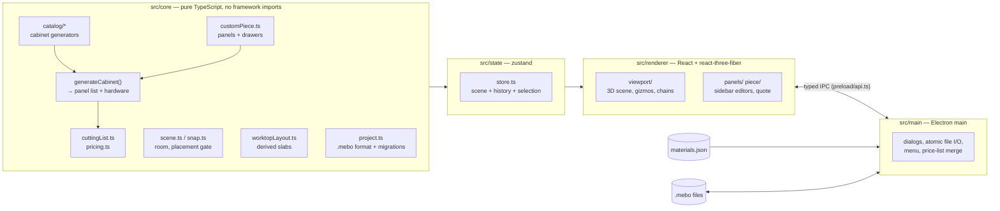

# Mebo 3D

[](https://github.com/Andeaf/mebo-3d/actions/workflows/ci.yml)

A Windows desktop application for a custom furniture workshop: a 3D kitchen
cabinet configurator that prices every design live from the workshop's own
material list.

Built for [Mebo](#about-the-client), a Dutch custom furniture maker, as the
tool its staff use to lay out a kitchen, build one-off pieces panel by panel
and quote the material cost — without a CAD licence and without a
spreadsheet.

**Status:** working internal tool, version 0.12.0, in active development.
Everything listed under [What it does](#what-it-does) is implemented, covered
by unit tests and shipped in the Windows installer. The source is published
**source-available** for reference and portfolio purposes (see
[License](#license)).

## What it does

- **Cabinet catalog.** Five parametric cabinet types — base, wall, tall,
  drawer and drawer-over-doors — each with width/height/depth, shelves, door
  leaves, drawer layouts and materials. Every cabinet is generated as a list
  of real cut panels (18 mm carcass, 3 mm back, overlay fronts, edge banding)
  plus its hardware.
- **Custom pieces.** A one-off piece is built panel by panel inside an
  envelope: sides, top, bottom, back, shelves, dividers, fronts and complete
  drawers, each with its own size, material and edge banding. Interior panels
  are kept inside the carcass, dimension chains show the gaps between
  neighbours, and dragged panels snap to the midpoint between their
  neighbours for equal compartments.
- **A room with walls.** Cabinets stand in a rectangular room, snap to each
  other and to the walls, turn their back to the wall they are dropped on,
  and can never overlap or leave the room — every placement goes through one
  gate in the core.
- **Worktops.** Slabs are derived from the base-cabinet runs on every change
  (never stored), bridge mixed depths, resolve corners into butt joints and
  are priced per slab.
- **Live pricing.** The cutting list of every cabinet (m² per board, metres
  of edge band, pieces of hardware) and every worktop slab is priced against
  an editable JSON price list; the quote updates on every edit.
- **Direct manipulation with a safety net.** Drag, rotate, nudge with the
  arrow keys, type coordinates, a translate gizmo for panels and drawers, a
  vertical arrow for hanging cabinets — and whole-document undo/redo with
  coalesced slider edits.
- **Projects on disk.** One design = one `.mebo` file (versioned JSON with
  migrations, strictly validated on load), with New / Open / Save / Save As,
  recent projects, atomic writes and an unsaved-changes guard on close.
- **Installable.** An NSIS installer (per user, no admin rights), `.mebo`
  file association with a single running instance, and a price list in the
  user's data folder that survives every update.
- **Three languages.** The UI is available in Dutch, English and Romanian;
  a missing translation key is a compile-time error.

## Tech stack

| Layer | Technology |
| --- | --- |
| Desktop shell | Electron 44, electron-vite 5 (Vite 7), electron-builder 26 (NSIS) |
| UI | React 19, TypeScript 7 |
| 3D | Three.js 0.185 via @react-three/fiber 9 and @react-three/drei 10 |
| State | zustand 5 |
| Tests | Vitest 4 — 513 tests in 43 files, all running in plain Node |
| Runtime | Node 24 for development; the installer targets Windows 10/11 x64 |

No backend, no network, no environment variables: the application is fully
offline. Prices live in a JSON file next to the app.

## Architecture



A few rules hold the design together:

- **The core is pure.** `src/core` imports nothing from Three.js, React,
  Electron or the filesystem; anything that needs I/O gets it injected. It
  is the part that is unit-tested exhaustively.
- **One source of truth per cabinet.** `generateCabinet(design)` yields the
  panel list; the 3D geometry *and* the cutting list / price are both
  derived from that single list. There is no second geometry model.
- **One placement gate.** Every mutation that moves a cabinet (add, drag,
  rotate, duplicate, parameter change, room resize) resolves through
  `placeWithoutOverlap`, which snaps to neighbours and walls and refuses a
  result that would overlap or leave the room. A loaded file is held to the
  same invariants instead of being repaired.
- **Derived, never stored.** Worktop slabs, dimension chains, runs and
  quotes are recomputed from the scene; the file holds settings only.
- **History is snapshots.** Undo/redo stores whole scene values with
  structural sharing; one function installs a new scene and records the
  previous one, so nothing else can forget to.
- **Millimetres everywhere** in the domain; only the renderer scales to
  metres.

## Running locally

Prerequisites: Node 22.12 or newer (Node 24 is used for development) and
npm. `npm install` downloads the Electron binary. Developed and tested on
Windows; the installer is Windows-only.

```bash
npm install
npm run dev        # the desktop app with hot reload
```

| Command | Purpose |
| --- | --- |
| `npm run dev` | Start the app with hot reload (electron-vite) |
| `npm test` | Run the unit tests once (Vitest) |
| `npm run test:watch` | Vitest in watch mode |
| `npm run typecheck` | `tsc --noEmit` for the web and the Node tsconfig |
| `npm run build` | Typecheck + production build to `out/` |
| `npm run dist` | Build + Windows installer → `release/Mebo-3D-Setup-<version>.exe` |
| `npm run icon` | Regenerate the placeholder `build/icon.ico` |

There is no `.env` file to create: the app reads no environment variables.

**Prices.** In development the app reads `data/materials.json` directly;
edit it and restart. The values in the repository are **example prices**, not
a supplier's list. The installed app copies that file on its first run to
`%APPDATA%\mebo-3d\materials.json` and from then on reads only that copy:
the workshop edits it in a text editor and reloads it from the *Prices*
menu without restarting. An update never overwrites it — a newer version
only appends material ids the file lacks, never modifies an entry and never
brings back a deleted one (`src/main/priceList.ts`).

## Testing

```bash
npm test
```

The tests cover the core (generators, placement, snapping, worktop layout,
pricing, the file format and its migrations, the custom-piece editor
logic), the pure state modules and the Node-only main-process modules.
They run without Electron or a DOM. One snapshot test pins every catalog
build number for number, so a refactor that changes a single panel size
fails loudly; it is only regenerated on purpose.

## Building the installer

`npm run dist` produces `release/Mebo-3D-Setup-<version>.exe`: a per-user
NSIS installer (no admin rights, `%LOCALAPPDATA%\Programs\Mebo 3D`), desktop
and Start-menu shortcuts, and the `.mebo` file association. The version
comes from `package.json`.

The installer is **not code-signed**. Windows SmartScreen shows "Unknown
publisher" on a downloaded copy; the user clicks *More info → Run anyway*.
Nothing in the build changes when a certificate is added.

The Dutch user manual for the workshop is [HANDLEIDING.md](HANDLEIDING.md).

## Technical decisions worth discussing

- **A pure domain core with injected I/O.** The price repository receives a
  `readJsonText` function; the main process and the tests inject different
  ones. The same shape would take a SQLite or HTTP implementation later.
- **Total, scalar parameters per cabinet type.** Every catalog kind's
  parameters are required primitives, so the `.mebo` decoder validates any
  kind against its *default params as a template* — adding a cabinet type
  means one generator file and one registry entry, with zero per-kind file
  format code. A custom piece (a panel list) deliberately breaks that rule
  and has its own hand-written strict decoder instead.
- **Strict file loading, lenient editing.** The editor clamps values into
  range; the file parser refuses out-of-range values, unknown keys,
  overlapping or out-of-room cabinets with a message naming the JSON path
  and the cabinet id. Schema migrations run as a chain indexed by the
  version they upgrade from and use frozen literals, never the live
  defaults.
- **Pose ranking instead of cost sums** for snapping: candidate poses are
  ranked by fewest side-to-wall contacts, then most flush contacts, then
  smallest displacement — which is what makes "turn your back to the wall"
  win over "you already happen to touch it".
- **Worktop joints as a terminating cut loop.** Slab intersections are
  resolved by cutting exactly one slab per pair (the one that loses less
  area); since slabs only shrink, the loop provably ends after at most
  n(n−1)/2 cuts and produces textbook butt joints in corners.
- **Dirty is not a flag.** It is `scene !== savedScene` by reference, and
  since an edit that lands on the same values installs nothing, undoing back
  to the saved state is clean without any bookkeeping.
- **A proxy object for the gizmo.** The translate gizmo is attached to an
  unscaled proxy `Object3D` glued to the selected panel's clamped anchor, so
  the meshes stay a pure derivation of the store and snapping (midpoint,
  equal gap, 10 mm grid) is done in the core, not by the control.
- **A price list that merges instead of overwriting.** On every load the
  shipped list is merged into the user's file by raw JSON value: new ids
  are appended, nothing existing is touched, and a sidecar remembers every
  id ever offered so a deleted material never comes back. Writes are atomic
  (temp + rename) in an order that survives a crash between any two.
- **Typed i18n.** The Dutch dictionary is the key authority (`as const`); the
  other languages are typed `Record<TranslationKey, string>`, so a missing
  or extra key anywhere is a compile error.

## Known limitations

- Rectangular rooms only; no doors, windows or ceiling check (a tall
  cabinet can exceed the wall height).
- Doors are excluded from the placement footprint: a perpendicular cabinet
  can visually graze a neighbour's door swing.
- Panels and drawers inside a custom piece are not collision-checked
  against each other; the 3D view is the review tool.
- Worktop settings (material, thickness, overhang) are scene-wide; no
  cutouts, end overhangs or edge profiles.
- Undo coalesces slider edits within a one-second window, so a drag that
  pauses longer becomes two entries.
- The installer is unsigned and there is no auto-update feed.

## Roadmap

Planned, in rough order: L-shaped rooms and openings (the wall model is
already a list of segments), corner cabinets, quote export (PDF), import of
the workshop's own 3D files through the existing `GeometrySource` seam,
per-run worktop options, code signing.

## About the client

Mebo is a Dutch custom furniture workshop. The application, its Dutch manual
and the example price list are tailored to its way of working; the
company's real prices are not part of this repository.

## License

Source-available — see [LICENSE](LICENSE). The code may be read for
reference and evaluation; it may not be copied, modified or used in another
product without written permission.
